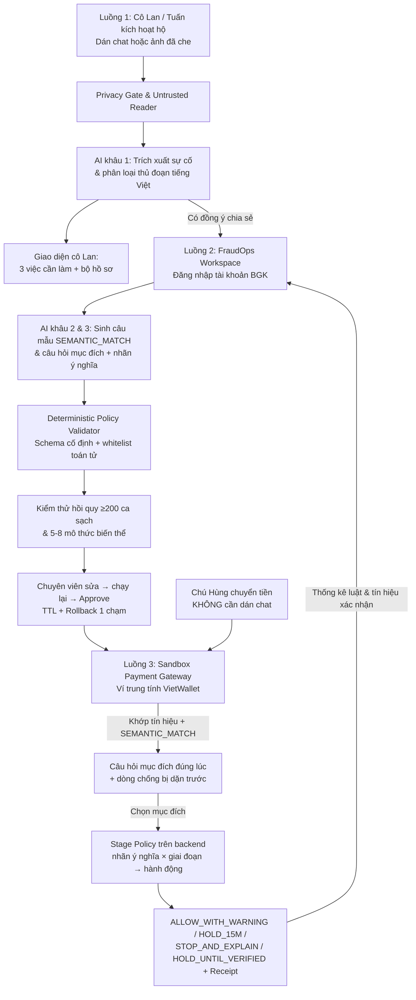

# ScamRelay — Khoanh vùng. Chặn đúng. Tiếp sức.

> **Một báo cáo từ người bị lừa hôm nay trở thành câu hỏi chặn đứng thủ đoạn mới cho người tiếp theo chỉ sau vài phút.**
>
> AI đọc hiểu ngữ cảnh. Chính sách kiểm soát thực thi. Con người phê duyệt. Bằng chứng xác nhận trạng thái.

**Phiên bản:** v2 (review ngày 27/11/2026). Nhật ký thay đổi so với v1 nằm ở Phụ lục A.
**Cuộc thi:** MoMo Tech Contest 2026, chủ đề *Imagine the Future Workspace (Human Centered. AI Powered.)*
**Chủ đề chính:** Chống lừa đảo. Mục tiêu là ngăn mất tiền hoặc lộ thông tin trước giao dịch nguy hiểm và trước thiệt hại tiếp theo.
**Chủ đề bổ trợ:** Trợ lý AI, An ninh mạng.
**Đội hình và hạn nộp:**
- 3 thành viên.
- Hạn nộp: 23:59:59 ngày 03/12/2026 (GMT+7). Đội đặt mục tiêu nộp trước 18:00.
- Duy trì sản phẩm trực tuyến tới MoMo TechDay ngày 11/12/2026.

---

## 1. Tóm tắt điều hành

**ScamRelay** giải quyết điểm mù "phút 89" của thanh toán số. Lừa đảo bắt đầu ở bên ngoài ứng dụng: mạng xã hội, tin nhắn, cuộc gọi. Hệ thống thanh toán chỉ thấy giao dịch ở khoảnh khắc cuối cùng, khi nạn nhân đã bị thao túng và sẵn sàng tự xác thực chuyển tiền.

ScamRelay không dừng ở chatbot tư vấn hay danh sách đen tài khoản. Sản phẩm xây một vòng lặp phòng thủ khép kín gồm 3 bước:

1. **Khoanh vùng (cô Lan và con trai).**
   - Biến đoạn chat rối rắm thành **3 việc cần làm ngay**.
   - Chặn có mức độ: phân biệt *bị thao túng* với *đã lộ OTP / bị chiếm tài khoản*.
   - Xuất bộ hồ sơ **"Kể 1 lần, dùng mọi nơi"** cho CSKH/ngân hàng, trình báo công an và đối chiếu bảo hiểm.
2. **Tiếp sức (Future Workspace của đội FraudOps).**
   - Khi cô Lan đồng ý chia sẻ hồ sơ, AI biên dịch thủ đoạn mới thành một **gói luật phòng vệ dạng JSON**. Gói luật gồm các mẫu ngữ nghĩa `SEMANTIC_MATCH` và một **câu hỏi mục đích đúng lúc**.
   - Hệ thống tự chạy kiểm thử hồi quy trên tập giao dịch sạch để đo tỷ lệ báo nhầm.
   - Chuyên viên xem kết quả, **sửa** nếu cần, rồi mới duyệt.
3. **Chặn đúng (chú Hùng, người tiếp theo).**
   - Chú Hùng chỉ chuyển tiền như bình thường, **không cần tự dán đoạn chat**.
   - Nếu giao dịch khớp tín hiệu của thủ đoạn mới, màn hình xác nhận hỏi một câu trung lập về mục đích chuyển tiền.
   - Nếu mục đích chú chọn khớp thủ đoạn, **giao dịch dừng lại trước khi tiền rời ví** và chú được giải thích rõ thủ đoạn.
   - Nếu chú chọn mục đích lành, giao dịch vẫn đi qua, kèm một dòng cảnh báo phòng trường hợp chú đã bị kẻ gian "dặn trước".

**Hai sản phẩm dùng được trực tuyến ngay, không phải bản mẫu tĩnh:**
- **ScamRelay Incident-to-Policy REST API**, có tài liệu Swagger/OpenAPI chạy thật.
  - Ví điện tử hoặc ngân hàng tích hợp API này để biên dịch báo cáo thành luật phòng vệ và chấm quyết định giao dịch.
  - Đi kèm một ví tích hợp tham chiếu mang thương hiệu trung tính là **VietWallet Sandbox**, không dùng nhận diện hay màu sắc của MoMo.
- **ScamRelay Web App** cho người dùng cuối và FraudOps.
  - Nạn nhân, hoặc người thân kích hoạt hộ, nhận hướng dẫn kèm kênh liên hệ chính thức đã xác minh và xuất bộ hồ sơ.
  - Chuyên viên FraudOps đăng nhập để duyệt, sửa và theo dõi vòng đời luật.

---

## 2. Bối cảnh, nỗi đau và độ khớp với cuộc thi

### 2.1. Nỗi đau thực tế tại Việt Nam

**Thủ đoạn mới xuất hiện nhanh.** Sinh trắc học và tuyên truyền đã giúp giảm các vụ chiếm đoạt tài khoản đơn thuần. Nhưng lừa đảo thao túng tâm lý chuyển sang kịch bản mới rất nhanh, ví dụ:
- Giả danh hỗ trợ chuẩn hóa tài khoản hộ kinh doanh theo quy định thuế mới năm 2026.
- Lừa đảo "dịch vụ thu hồi tiền" nhắm vào chính những người từng bị lừa.

> ⚠️ **Lưu ý trước khi khóa slide ngày 03/12:** chỉ đưa lên slide những số liệu đội đã tự mở báo cáo gốc để kiểm chứng (GASA, cơ quan chức năng Việt Nam). Danh sách cần kiểm chứng nằm ở Phụ lục B.

**Ba đứt gãy chưa được nối liền:**
1. **Đứt gãy ngữ cảnh.** Cổng thanh toán chỉ thấy tín hiệu giao dịch, không thấy câu chuyện thao túng diễn ra ngoài app.
2. **Đứt gãy thao tác trong giờ vàng.** Nạn nhân đang hoảng loạn, hoặc điện thoại đang bị kẻ gian điều khiển, phải tự đối chiếu nhiều nguồn tiền và kể lại câu chuyện 3–4 lần cho CSKH, ngân hàng, công an và bảo hiểm.
3. **Đứt gãy tốc độ phản ứng.** Từ báo cáo đầu tiên về một thủ đoạn mới đến khi luật bảo vệ tới được người dùng tiếp theo cần nhiều bước thủ công: tổng hợp, viết luật, kiểm thử, triển khai.

> *Ghi chú:* chỉ ghi một con số cụ thể (ví dụ "nhiều ngày") nếu có nguồn. Không có nguồn thì giữ cách diễn đạt định tính như trên.

### 2.2. Độ khớp với đề bài và hệ sinh thái MoMo

**Trúng trọng tâm "Imagine the Future Workspace".** Nhân vật chính của ScamRelay là **chuyên viên FraudOps và CSKH**. Thay vì đọc hàng chục ảnh chụp rời rạc và viết luật thủ công, họ nhận hồ sơ có cấu trúc. Họ cũng nhận một bản nháp luật mà AI đã kiểm thử sẵn, nên chỉ cần dành thời gian cho việc đòi hỏi phán đoán: sửa, duyệt hoặc thu hồi luật. Người dùng cuối là hai đầu của câu chuyện; màn hình làm việc của chuyên viên là trung tâm.

**Bổ sung đúng mảnh còn thiếu, không làm lại thứ MoMo đã có.**
- MoMo đã đầu tư vào chấm điểm rủi ro thời gian thực và cho biết đang hợp tác với Bộ Công an (A05) dùng AI phát hiện giao dịch bất thường ([MoMo, 09/07/2026](https://www.momo.vn/tin-tuc/thong-bao/momo-va-bo-cong-an-dong-hop-tac-day-lui-lua-dao-8893); xem Phụ lục B).
- ScamRelay không làm lại bộ lọc danh sách đen, chatbot chi tiêu hay hệ thống chấm điểm rủi ro.
- Sản phẩm tập trung vào **tốc độ biến ngữ cảnh của 1 nạn nhân thành câu hỏi phòng vệ đúng lúc cho người tiếp theo**.
- Điểm rủi ro sẵn có của ví đối tác được đưa vào luật qua trường `partner_risk_score`. Như vậy ScamRelay là lớp ngữ cảnh đặt **bên trên** hệ thống hiện có.
- Định hướng dài hạn là API liên thông, tạo một "liên minh phòng thủ chủ động" giữa nhiều ví và ngân hàng.

---

## 3. Ba luồng sản phẩm cốt lõi

**Nhân vật dùng xuyên suốt:**
- **Cô Lan:** chủ tiệm tạp hóa hộ kinh doanh, là nạn nhân đầu tiên.
- **Tuấn:** con trai cô Lan, kích hoạt hộ cho mẹ.
- **Chú Hùng:** chủ tiệm sửa xe hộ kinh doanh, là người tiếp theo bị nhắm tới.
- **Chị Mai:** chuyên viên FraudOps.

### 3.1. Khoanh vùng — dành cho cô Lan và người thân (Human-Centered)

**Kích hoạt từ thiết bị khác (Proxy Activation)**

Chế độ *"Tôi là người thân kích hoạt hộ"* dành cho tình huống máy của nạn nhân đang bị kẻ gian dẫn dụ hoặc nghi bị chiếm quyền.

Nguyên tắc: **kích hoạt hộ chỉ làm tài khoản an toàn hơn, không bao giờ làm yếu đi.** Cụ thể:
- Người thân được phép:
  - Nhận hướng dẫn.
  - Xuất bộ hồ sơ, trong đó thông tin định danh của nạn nhân đã được che.
  - Yêu cầu *tạm giữ bảo vệ* trên ví của nạn nhân.
- Người thân **không** được:
  - Chuyển tiền.
  - Gỡ bất kỳ hạn chế nào.
  - Xem số dư hay lịch sử giao dịch đầy đủ.
- Chủ tài khoản nhận thông báo ngay khi có kích hoạt hộ.
- Chỉ chủ tài khoản mới gỡ được tạm giữ, và phải xác minh qua kênh chính thức.

Nhờ vậy, kẻ gian không thể lợi dụng tính năng này để khóa phá tài khoản người khác hay dò thông tin.

**Giao diện chống hoảng loạn**
- Lược bỏ thuật ngữ và đồ thị.
- Hiển thị tối đa **3 việc cần làm ngay**, với nút thao tác lớn.
- Số tổng đài và đường dẫn chính thức lấy từ **danh mục tĩnh đã kiểm chứng**. LLM không được tự tạo hotline hay link.

**Chặn có mức độ (Adaptive Containment)**

Áp dụng trên ví VietWallet Sandbox của cô Lan:
- **Mức thao túng tâm lý** (chưa lộ thông tin đăng nhập):
  - Tạm giữ các khoản chuyển rủi ro.
  - Hóa đơn thiết yếu quen thuộc (ví dụ tiền điện từ biller đã xác minh) vẫn đi qua.
- **Mức nghi xâm phạm tài khoản** (lỡ đọc OTP hoặc mật khẩu):
  - Tự động nâng chính sách ngay lập tức, khóa toàn bộ giao dịch đi, kể cả ngoại lệ hóa đơn quen.
  - Hướng dẫn liên hệ từng tổ chức liên quan.
  - Không bao giờ tự đánh dấu ngân hàng bên ngoài là "đã khóa" chỉ vì người dùng báo đã gọi điện.

**Kể 1 lần, dùng mọi nơi**

Từ một lần nhập ngữ cảnh, hệ thống xuất 1 gói hồ sơ dạng Markdown (PDF nếu kịp) gồm 3 mục:
1. Tóm tắt có dẫn chiếu bằng chứng, dành cho CSKH/ngân hàng.
2. Dòng thời gian để trình báo công an.
3. Danh mục chứng từ để đối chiếu bảo hiểm. Mục này ghi rõ chỉ hỗ trợ chuẩn bị hồ sơ, không kết luận quyền bồi thường.

**Đồng ý chia sẻ có kiểm soát**

Trước khi hồ sơ được chuyển sang FraudOps, cô Lan (hoặc Tuấn) thấy một màn hình đồng ý ghi rõ ba điều:
- Chia sẻ những gì: tóm tắt thủ đoạn và các trường giao dịch đã che định danh.
- Dùng để làm gì: tạo luật bảo vệ người khác.
- Lưu trong bao lâu: bản thật xóa theo TTL của luật; bản sandbox chỉ lưu trong workspace demo và xóa khi Reset.

Ảnh chụp gốc không bao giờ rời khỏi khâu Privacy Gate.

### 3.2. Tiếp sức — FraudOps Workspace (Future Workspace)

**Hồ sơ chuyển giao có đồng ý.** Chị Mai (đăng nhập bằng tài khoản giám khảo) thấy ngay tóm tắt sự cố và phạm vi ảnh hưởng, không phải đọc lại hàng chục ảnh rời rạc.

**AI biên dịch luật (AI Defense Compiler)**
- AI rút bản chất thủ đoạn từ vụ của cô Lan để sinh bản nháp `RelayRule` theo schema cố định.
- Bản nháp gồm các câu mẫu ngữ nghĩa (`SEMANTIC_MATCH`) và bộ **câu hỏi mục đích đúng lúc**.
- AI chỉ gán *nhãn ý nghĩa* cho từng phương án trả lời: `BENIGN`, `TACTIC_MATCH` hoặc `UNCLEAR`.
- **Hành động cụ thể (cho qua, dừng, tạm giữ) do backend quyết định theo giai đoạn của luật** (xem mục 4.3). LLM không bao giờ trực tiếp quyết định chặn hay cho qua.

**Kiểm thử an toàn trước khi duyệt**
- **Kiểm thử hồi quy trên tập giao dịch sạch** (≥ 200 mẫu):
  - Hiển thị số giao dịch sạch bị khớp nhầm, dạng "flagged / checked", kèm ví dụ cụ thể.
  - **Nút Approve bị khóa nếu có giao dịch sạch bị khớp nhầm**, trừ khi chuyên viên nhập lý do ghi đè. Lý do này được lưu vào log kiểm toán.
- **5–8 mô thức biến thể có cấu trúc** để kiểm tra độ phủ của luật. Mô thức chỉ gồm thông số giao dịch và ý đồ thao túng, tuyệt đối không xuất đoạn văn lừa đảo nguyên văn có thể bị lạm dụng.

**Con người sửa, duyệt và thu hồi**

Đây là khoảnh khắc chứng minh giá trị của con người trong vòng lặp:
- Chuyên viên **sửa trực tiếp** các câu mẫu, ví dụ xóa một cụm quá rộng khiến giao dịch sạch bị khớp nhầm, rồi chạy lại kiểm thử.
- Chuyên viên chọn giai đoạn triển khai và bấm **Approve**.
- Đồng hồ kích hoạt luật ghi **hai mốc riêng**: thời gian AI biên dịch + kiểm thử, và thời gian con người xem xét.
- Luôn có nút **Rollback 1 chạm** để tắt luật ngay.

**Bảng theo dõi luật (khép vòng "Relay"; làm nếu kịp).** Mỗi luật đang chạy có một bảng số liệu:
- Số lần đã hỏi.
- Số lần người dùng tự chọn mục đích khớp thủ đoạn.
- Số lần chọn "Khác".
- Số khiếu nại báo nhầm.

Khi người dùng ở luồng chặn tự chọn mục đích khớp thủ đoạn, sự kiện đó được ghi nhận như một tín hiệu xác nhận. Tín hiệu này chỉ **gợi ý** chuyên viên nâng giai đoạn luật, **không tự động nâng**.

### 3.3. Chặn đúng — chú Hùng trên VietWallet Sandbox

**Không đòi chú Hùng tự dán đoạn chat.** Chú chỉ chuyển tiền như bình thường.

**Lọc 2 lớp: lưới rộng trước, lọc chính xác sau**

1. **Lớp 1: tín hiệu quan sát được + `SEMANTIC_MATCH`.**
   - Nội dung chuyển khoản được chuẩn hóa: bỏ dấu, mở rộng viết tắt như "HKD" → "hộ kinh doanh", "MST" → "mã số thuế".
   - Sau đó gateway so độ tương đồng embedding với các câu mẫu của thủ đoạn.
   - Kết hợp thêm tín hiệu giao dịch: số tiền, biller đã xác minh hay chưa, `partner_risk_score`.
   - Vì lớp này chỉ thêm 1 câu hỏi, lưới được đặt đủ rộng để ít bỏ sót.
2. **Lớp 2: câu hỏi mục đích trung lập.**
   - Khi Lớp 1 khớp, ví hỏi **về mục đích giao dịch**, không hỏi *"bạn có đang bị lừa không?"*.
   - Lý do: nạn nhân tin câu chuyện kẻ gian dựng lên nên thường chọn đúng mục đích họ tin là thật.
   - Các phương án được viết theo **nhóm mục đích chung**, không nêu đúng tên thủ đoạn, để kẻ gian khó dò ra đáp án nào bị dừng.

> *"Khoản chuyển này dùng để làm gì?"*
> - ○ Mua hàng / trả tiền dịch vụ → `BENIGN`
> - ○ Chuyển cho người thân, bạn bè → `BENIGN`
> - ○ Nộp phí, thuế hoặc phí xác minh theo yêu cầu của người tự xưng là cán bộ / cơ quan nhà nước → `TACTIC_MATCH`
> - ○ Mục đích khác → `UNCLEAR`
>
> Dòng hiển thị cho **mọi** giao dịch đã khớp Lớp 1, bất kể chọn gì:
> *"Nếu có người dặn bạn chọn một đáp án cụ thể ở màn hình này, đó là dấu hiệu lừa đảo. Hãy dừng lại và gọi kênh chính thức."*

**Chống dò đáp án (nếu kịp).** Nếu cùng một tài khoản gặp câu hỏi của cùng một luật từ 2 lần trở lên trong 24 giờ và chọn các đáp án khác nhau, giao dịch tiếp theo bị `HOLD_15M`. Hành vi đổi đáp án là dấu hiệu bị dặn hoặc đang thử luật.

---

## 4. Kiến trúc, vai trò của AI và rào chắn an toàn



### 4.1. AI là thành phần cốt lõi ở đúng 3 khâu mà quy tắc cứng không thay được

1. **Hiểu ngữ cảnh tiếng Việt phi cấu trúc của cô Lan.** AI đọc hội thoại đời thường nhiều tiếng lóng để tách ra:
   - Khoản đã mất và khoản sắp chuyển.
   - Dấu hiệu đã lộ OTP.
   - Bản chất của thủ đoạn mới.
   - *Đọc ảnh chụp màn hình là tính năng mở rộng; bản nộp ưu tiên văn bản dán vào.*
2. **Sinh câu mẫu ngữ nghĩa (`SEMANTIC_MATCH`).** AI tạo tập cụm diễn đạt tương đương cho thủ đoạn mới, để hệ thống bắt được biến thể bằng độ tương đồng embedding. Kẻ gian đổi vài từ khóa không vô hiệu hóa được luật. Hiệu quả so với luật từ khóa được đo riêng (mục 6.4).
3. **Sinh câu hỏi mục đích trung lập.** AI thiết kế câu hỏi và các phương án khớp với câu chuyện kẻ gian đang dùng. Nhờ đó hệ thống khai thác được ngữ cảnh từ người dùng mà không buộc họ tự nhận mình bị lừa.

### 4.2. Tách quyền và chống đầu độc luật

**Separation of Authority**
- LLM chỉ phân tích và đề xuất bản nháp JSON kèm nhãn ý nghĩa.
- Backend (`DeterministicValidator`, `StagePolicy`, `PaymentGateway`) kiểm tra hợp lệ, lưu trạng thái, **chọn hành động** và thực thi tại thời điểm commit.
- LLM không bao giờ được tự triển khai luật, tự chọn hành động chặn hay tự mở khóa tài khoản.

**Luật nhắm vào thủ đoạn, không khóa tài khoản cụ thể**
- Schema cấm đưa số tài khoản cá nhân vào `RelayRule`.
- Một báo cáo giả nhắm vào đối thủ không thể làm khóa tài khoản của đối thủ.
- Nếu báo cáo giả cố cài câu mẫu trùng với nội dung giao dịch hợp lệ phổ biến (ví dụ "thanh toan don hang"), kiểm thử hồi quy trên tập sạch sẽ bắt được và **khóa nút Approve**.

**Vòng đời luật theo mức xác nhận**
- Mọi luật mới bắt đầu ở `SHADOW_LOG` hoặc `ASK_ONLY`.
- Muốn nâng lên `ENFORCE_HOLD` cần **cả hai** điều kiện:
  - Có từ 2 báo cáo độc lập trở lên (`corroboration_count >= 2`), tính theo số tài khoản đã xác minh khác nhau.
  - Chuyên viên duyệt lần hai.
- Mọi luật có hạn sống (`ttl_hours`) và tự tắt nếu không được gia hạn.

**Bảo vệ bản deploy công khai (đến 11/12)**
- Tab FraudOps và bộ sinh biến thể bắt buộc đăng nhập bằng tài khoản giám khảo.
- Bộ sinh biến thể chỉ trả cấu trúc, không sinh văn bản lừa đảo hoàn chỉnh.
- Có rate limit theo phiên.
- Không thu thập dữ liệu định danh thật (OTP, CCCD, mật khẩu).
- Chống prompt injection từ nội dung người dùng tải lên.

### 4.3. Chính sách hành động theo giai đoạn (Stage Policy)

Bảng này giải quyết câu hỏi: *"Một luật mới chỉ có 1 báo cáo thì được phép tác động tới đâu?"*

| Giai đoạn | Điều kiện | Lớp 1 khớp | Chọn `TACTIC_MATCH` | Chọn `BENIGN` | Chọn `UNCLEAR` |
|---|---|---|---|---|---|
| `SHADOW_LOG` | Mới tạo, chưa duyệt | Chỉ ghi log, không hỏi | — | — | — |
| `ASK_ONLY` | Đã qua kiểm thử hồi quy + 1 người duyệt | Hỏi mục đích | `STOP_AND_EXPLAIN` | `ALLOW_WITH_WARNING` | `HOLD_15M` |
| `ENFORCE_HOLD` | `corroboration_count >= 2` + duyệt lần hai | Hỏi mục đích | `HOLD_UNTIL_VERIFIED` | `ALLOW_WITH_WARNING` | `HOLD_15M` |

**Ý nghĩa từng hành động:**
- **`STOP_AND_EXPLAIN`:** giao dịch **không được thực hiện, 0đ rời ví**. Người dùng thấy giải thích thủ đoạn và kênh chính thức để kiểm chứng. Người dùng được tạo lại giao dịch sau 30 phút. Đây là "dừng mềm": người dùng vẫn giữ quyền với tiền của mình, nhưng phải qua một khoảng tỉnh táo.
- **`HOLD_UNTIL_VERIFIED`:** giao dịch bị giữ cho tới khi người dùng xác minh qua kênh chính thức. Chỉ áp dụng khi thủ đoạn đã được nhiều nguồn độc lập xác nhận.
- **`ALLOW_WITH_WARNING`:** giao dịch đi qua, kèm dòng chống "bị dặn trước".
- **Ngoại lệ:** trong mọi giai đoạn, biller đã xác minh (`is_verified_biller = true`) **không bao giờ** bị hỏi. Ví dụ: nộp thuế thật qua kênh chính thức vẫn đi qua bình thường.

**Tác động tối đa của một báo cáo đơn lẻ (kể cả báo cáo giả):** một câu hỏi, và chỉ khi chính người dùng tự chọn mục đích khớp thủ đoạn thì mới có một lần dừng mềm 30 phút.

### 4.4. Giới hạn đã biết (trình bày trung thực với BGK)

1. **Nạn nhân bị dặn chọn đáp án lành.**
   - Lớp 2 không chặn được trường hợp này.
   - Biện pháp giảm thiểu: dòng cảnh báo chống bị dặn trước, cơ chế chống dò đáp án (nếu kịp), và `partner_risk_score` làm mức sàn.
   - Kết quả đo riêng ở mục 6.
2. **Nội dung chuyển khoản trống hoặc vô hại.**
   - `SEMANTIC_MATCH` không có tín hiệu trong trường hợp này.
   - Luật phải dựa vào `partner_risk_score` và các tín hiệu giao dịch khác.
   - Đây là lý do ScamRelay được định vị là lớp *bổ sung* cho hệ thống chấm điểm sẵn có.
3. **Phạm vi sandbox.** VietWallet Sandbox là ví tham chiếu. Tích hợp thật cần dữ liệu, quy trình và phê duyệt của đối tác.

---

## 5. Schema cố định và hợp đồng OpenAPI

### 5.1. JSON Schema cho gói phòng vệ (`RelayRule`)

`DeterministicValidator` chỉ chấp nhận các trường và toán tử trong whitelist:

- **`ALLOWED_FIELDS`:** `amount_vnd`, `transfer_note`, `recipient_is_new`, `recipient_account_age_days`, `tx_count_10m`, `is_verified_biller`, `account_compromise_flag`, `partner_risk_score`
  - `partner_risk_score` có giá trị 0–100, do ví đối tác cung cấp. Trong sandbox, giá trị này được mô phỏng.
- **`ALLOWED_OPS`:** `EQ`, `LTE`, `GTE`, `SEMANTIC_MATCH`, `CONTAINS_ANY`, `NOT_CONTAINS_ANY`
  - `SEMANTIC_MATCH` chuẩn hóa văn bản trước, rồi so cosine similarity embedding với ngưỡng đã hiệu chỉnh trên tập dev.
- **`ALLOWED_OUTCOMES`** (nhãn LLM được phép gán cho phương án): `BENIGN`, `TACTIC_MATCH`, `UNCLEAR`
- **`ACTIONS`** (chỉ backend chọn, theo mục 4.3): `ALLOW`, `ALLOW_WITH_WARNING`, `HOLD_15M`, `STOP_AND_EXPLAIN`, `HOLD_UNTIL_VERIFIED`

```json
{
  "rule_id": "RL-20261127-TAX01",
  "source_incident_id": "INC-A-204",
  "target_scope": "TACTIC_PATTERN",
  "tactic_family": "FAKE_HKD_TAX_VERIFICATION_2026",
  "lifecycle": {
    "stage": "ASK_ONLY",
    "ttl_hours": 24,
    "corroboration_count": 1,
    "approved_by": "judge_fraudops_01",
    "benign_regression": { "checked": 240, "flagged": 0 },
    "variant_coverage": { "checked": 6, "triggered": 6 },
    "edited_by_human": true
  },
  "observable_signals": {
    "match_mode": "ALL",
    "conditions": [
      {
        "field": "transfer_note",
        "op": "SEMANTIC_MATCH",
        "normalize": ["strip_diacritics", "expand_abbreviations"],
        "anchor_phrases": [
          "dong phi xac minh tai khoan ho kinh doanh",
          "cap nhat thue ho kinh doanh 2026",
          "phi kich hoat ma so thue dien tu"
        ],
        "threshold": 0.78
      },
      { "field": "amount_vnd", "op": "GTE", "value": 200000 },
      { "field": "is_verified_biller", "op": "EQ", "value": false }
    ]
  },
  "jit_purpose_question": {
    "question_vi": "Khoản chuyển này dùng để làm gì?",
    "options": [
      { "id": "PURCHASE", "label_vi": "Mua hàng / trả tiền dịch vụ", "outcome": "BENIGN" },
      { "id": "KNOWN_PERSON", "label_vi": "Chuyển cho người thân, bạn bè", "outcome": "BENIGN" },
      {
        "id": "AUTHORITY_FEE",
        "label_vi": "Nộp phí, thuế hoặc phí xác minh theo yêu cầu của người tự xưng là cán bộ / cơ quan nhà nước",
        "outcome": "TACTIC_MATCH"
      },
      { "id": "OTHER", "label_vi": "Mục đích khác", "outcome": "UNCLEAR" }
    ],
    "tactic_alert_vi": "Cảnh báo thủ đoạn mới vừa ghi nhận: Cơ quan thuế và đơn vị trung gian thanh toán không yêu cầu chuyển phí vào tài khoản cá nhân để xác minh hay cập nhật tài khoản hộ kinh doanh.",
    "anti_coaching_notice_vi": "Nếu có người dặn bạn chọn một đáp án cụ thể ở màn hình này, đó là dấu hiệu lừa đảo. Hãy dừng lại và gọi kênh chính thức."
  }
}
```

*Thay đổi so với v1 trong ví dụ trên:*
- Điều kiện số tiền đổi từ `LTE 5.000.000` sang `GTE 200.000`. Mức trần cũ vô tình để lọt các khoản lớn, đúng loại kẻ gian muốn nhất. Mức sàn mới tránh hỏi các khoản quá nhỏ.
- Thêm điều kiện `is_verified_biller = false`, để nộp thuế thật qua biller chính thức không bị hỏi.
- Phương án trả lời chỉ mang nhãn ý nghĩa; hành động do `StagePolicy` quyết định.

### 5.2. Các endpoint OpenAPI (FastAPI `/docs`)

| Nhóm | Endpoint | Chức năng |
| :--- | :--- | :--- |
| **Khoanh vùng** | `POST /v1/incidents/analyze` | Nhận chat đã che, cờ kích hoạt hộ và tình tiết mới (ví dụ lộ OTP). Trả về 3 việc cần làm, chính sách cho ví của nạn nhân và kênh chính thức. |
| **Tiếp sức** | `POST /v1/fraudops/rules/compile` | AI biên dịch `RelayRule` và 5–8 mô thức biến thể *(cần đăng nhập BGK)*. |
| **Tiếp sức** | `POST /v1/fraudops/rules/{id}/regression-test` | Chạy validator và kiểm thử hồi quy. Trả về `flagged/checked` kèm ví dụ khớp nhầm. |
| **Tiếp sức** | `POST /v1/fraudops/rules/{id}/approve` | Duyệt luật vào gateway theo giai đoạn. Bị từ chối nếu `flagged > 0` mà không có lý do ghi đè. Ghi lại 2 mốc thời gian. |
| **Tiếp sức** | `POST /v1/fraudops/rules/{id}/rollback` | Thu hồi luật về `ROLLED_BACK` trong 1 chạm. |
| **Chặn đúng** | `POST /v1/gateway/evaluate-transfer` | Chấm giao dịch song song trên baseline hành vi thuần và ScamRelay. Trả về `ALLOW` hoặc `CHALLENGE_JIT`. |
| **Chặn đúng** | `POST /v1/gateway/submit-challenge` | Nhận lựa chọn mục đích. `StagePolicy` trả quyết định cuối cùng kèm `Receipt`. |
| *(Nếu kịp)* | `GET /v1/fraudops/rules/{id}/stats` | Bảng theo dõi luật: số lần hỏi, số lần chọn khớp thủ đoạn, số khiếu nại. |

---

## 6. Phương pháp đánh giá định lượng

### 6.1. Một đối chứng chính, công bằng

Hai hệ thống được chấm trên **cùng một tập giao dịch**:
- **Baseline:** bộ chấm rủi ro hành vi thuần, chỉ dựa trên số tiền, người nhận mới/cũ và tần suất, không có ngữ cảnh ngoài app.
- **ScamRelay:** hành vi + ngữ cảnh khoanh vùng + luật tiếp sức.

### 6.2. Dữ liệu

**Tập dev:** 12 ca, dùng để tinh chỉnh prompt và hiệu chỉnh ngưỡng `SEMANTIC_MATCH`.

**Tập held-out viết tay:** 10–12 ca.
- Thành viên 3 viết và giữ trên máy riêng. **Người tinh chỉnh prompt (Thành viên 1) không xem tập này**; prompt và ngưỡng chỉ được chỉnh trên tập dev.
- Held-out được mở và chạy **đúng 1 lượt** sau Feature Freeze; sau đó không sửa prompt hay ngưỡng. File được commit cùng kết quả.
- Tuyệt đối không dùng LLM để sinh biến thể cho held-out.
- Nếu kịp, nhờ thêm 1–2 người ngoài đội viết vài ca để giảm thiên lệch của người hiểu hệ thống.

Cơ cấu gợi ý của tập held-out:

| Loại ca | Số ca | Mục đích |
|---|---|---|
| Biến thể thủ đoạn mới, nội dung diễn đạt khác hẳn bản gốc | 4 | Đo khả năng bắt biến thể |
| Lừa "dịch vụ thu hồi tiền" nhắm vào người từng bị lừa | 1 | Thủ đoạn tái diễn |
| Lộ OTP / chiếm tài khoản | 1 | Kiểm tra nâng mức khóa |
| **Nạn nhân bị dặn trước** (chọn đáp án lành) | 2 | Đo trung thực giới hạn của Lớp 2 |
| **Nội dung chuyển khoản trống hoặc vô hại** | 1 | Đo trung thực giới hạn của `SEMANTIC_MATCH` |
| Giao dịch hợp lệ dễ nhầm (nộp thuế thật, tiền cọc, hoàn tiền cho khách) | 3 | Đo báo nhầm |

**Câu trả lời của nạn nhân trong mỗi ca được viết trước.** Người viết ca ghi bằng lời tự do điều nạn nhân tin là thật, ví dụ *"tôi đang nộp phí xác minh cho cán bộ thuế"* hoặc *"người ta dặn chọn chuyển cho người quen"*. Khi chạy đánh giá, Thành viên 2 (không viết ca) ánh xạ câu trả lời đó sang phương án mà hệ thống sinh ra, và **bảng ánh xạ được công bố trong phụ lục slide**. Cách này tránh việc người viết ca vô tình chọn sẵn đáp án "đúng".

**Tập giao dịch sạch cho kiểm thử hồi quy:** ≥ 200 mẫu.
- Sinh bằng template từ nội dung chuyển khoản hợp lệ thường gặp: tiền nhà, tiền hàng, học phí, chia tiền ăn...
- Tập này không liên quan đến thủ đoạn, nên sinh tự động không gây vấn đề "mô hình tự chấm mình".

### 6.3. Ba chỉ số trên slide (luôn ghi dạng x/n bên cạnh phần trăm)

1. **Unsafe Allow Rate.** Tỷ lệ ca lừa đảo bị để lọt, tính đầu-cuối. So trực tiếp baseline với ScamRelay, ví dụ "Baseline lọt 9/9, ScamRelay lọt 2/9".
2. **Legitimate Allow Rate và tỷ lệ bị hỏi.**
   - Tỷ lệ giao dịch hợp lệ đi qua, đo trên ca khó (x/3) và trên tập sạch (x/200+).
   - Kèm **tỷ lệ giao dịch sạch bị hỏi**, tức chi phí trải nghiệm thật sự của lưới rộng.
3. **Variant Trigger Rate và thời gian kích hoạt luật.**
   - Tỷ lệ biến thể viết tay làm Lớp 1 bật câu hỏi. Đây là thước đo trực tiếp năng lực `SEMANTIC_MATCH`, không phụ thuộc câu trả lời của nạn nhân.
   - Thời gian kích hoạt luật, tách 2 mốc: AI biên dịch + kiểm thử, và con người xem xét.

### 6.4. Phụ lục slide (đo nếu kịp, rất nên có)

- **Ablation với luật từ khóa.** So `SEMANTIC_MATCH` với một luật `CONTAINS_ANY` do người viết trên cùng các biến thể, để chứng minh trực tiếp giá trị của AI.
- **Kết quả riêng cho các ca bị dặn trước và ca nội dung trống**, nói rõ đây là giới hạn đã biết.
- **Đường quét ngưỡng `SEMANTIC_MATCH`** trên tập dev, để giải thích vì sao chọn 0.78.

---

## 7. Kịch bản demo 3 phút (video và giám khảo tự trải nghiệm)

| Thời lượng | Diễn biến trên hệ thống | Điểm gây ấn tượng với BGK |
| :--- | :--- | :--- |
| **0:00 – 0:15** | **Vấn đề "phút 89":** cô Lan nhận cuộc gọi giả danh cán bộ thuế yêu cầu "chuẩn hóa tài khoản hộ kinh doanh 2026". Mọi thao túng diễn ra ngoài app; khi vào đến ví đã là phút cuối. | Đặt vấn đề trung thực, sát thời sự. |
| **0:15 – 0:45** | **Khoanh vùng:** Tuấn kích hoạt hộ cho mẹ từ máy khác và dán đoạn chat yêu cầu chuyển 1,8 triệu "phí xác minh". App hiện **3 việc cần làm**, xuất bộ hồ sơ, tạm giữ khoản nghi vấn, nhưng hóa đơn điện 400k vẫn qua. Nhập thêm *"Mẹ lỡ đọc OTP"* → khóa cứng cả hóa đơn điện. | Nhân văn, gọn gàng, chặn có mức độ. |
| **0:45 – 1:00** | **Chú Hùng, trước khi có luật:** chuyển 1,2 triệu tới một tài khoản không mới, nội dung diễn đạt khác (*"xac thuc ho so cap nhat thue HKD"*). Baseline hành vi thuần → **lọt (`ALLOW`)**. | Mốc so sánh công bằng trên cùng một giao dịch. |
| **1:00 – 1:55** | **Tiếp sức (FraudOps Workspace):** chị Mai đăng nhập. AI biên dịch `RelayRule`. Kiểm thử hồi quy **bắt được 3 giao dịch sạch bị khớp nhầm** do câu mẫu quá rộng *"cap nhat thong tin tai khoan"*, và nút Approve bị khóa. Chị Mai xóa câu mẫu đó, chạy lại → **0/240 khớp nhầm**, 6/6 biến thể bật câu hỏi. Approve (`ASK_ONLY`) → đồng hồ: *"AI: X giây · Con người xem xét: Y giây"*. | Khoảnh khắc **Future Workspace**: AI làm phần nặng, kiểm thử phát hiện lỗi của AI, con người sửa và chịu trách nhiệm. |
| **1:55 – 2:30** | **Chặn đúng, sau khi có luật:** chạy lại đúng giao dịch của chú Hùng (hoặc giám khảo tự gõ biến thể khác, **không cần dán chat**). Câu hỏi mục đích bật lên kèm dòng chống bị dặn trước. Chú Hùng chọn *"Nộp phí… theo yêu cầu người tự xưng cán bộ"* → **giao dịch dừng lại, 0đ rời ví**, kèm giải thích thủ đoạn. Thử giao dịch mua hàng thật → vẫn qua bình thường. | Khoảnh khắc **wow**: không bắt nạn nhân tự nhận bị lừa, không làm phiền người mua thật. |
| **2:30 – 3:00** | **Bằng chứng và tầm nhìn:** 3 chỉ số đo trên tập held-out (dạng x/n, có cả các ca hệ thống bỏ lọt). Mở nhanh `/docs` để chứng minh khả năng tích hợp liên ví/ngân hàng. Nêu rõ ranh giới của bản sandbox. | Trung thực kỹ thuật, tầm nhìn hệ sinh thái rõ ràng. |

**Trước khi quay video:** chạy thử chính xác các câu trong kịch bản qua `SEMANTIC_MATCH`, đặc biệt câu có "HKD", để chắc chắn vượt ngưỡng. Lưu sẵn kết quả biên dịch luật của ca demo làm đường dự phòng khi API LLM chậm hoặc lỗi.

---

## 8. Phạm vi, phân công và lịch trình (27/11 – 03/12/2026)

### 8.1. Ưu tiên phạm vi

| Mức | Hạng mục |
|---|---|
| **Bắt buộc có** | Vòng lặp xuyên suốt: chat của cô Lan → biên dịch → kiểm thử hồi quy → sửa → Approve → câu hỏi cho chú Hùng → `StagePolicy` → quyết định. FraudOps có Approve/Rollback. VietWallet hiển thị trước/sau. `/docs`. Script benchmark. Deploy ổn định kèm đường dự phòng không phụ thuộc LLM. |
| **Nên có** | Kích hoạt hộ (với các giới hạn ở mục 3.1). Nâng mức khóa khi lộ OTP. Xuất hồ sơ Markdown (dựng ngay trên trình duyệt). `ALLOW_WITH_WARNING`. |
| **Có thể có** | Cưỡng chế khoảng chờ 30 phút sau `STOP_AND_EXPLAIN`. Bảng theo dõi luật. Ablation với luật từ khóa. Chống dò đáp án. Xuất PDF. Đọc ảnh chụp màn hình. Bộ sinh biến thể động (5 biến thể cố định là đủ). |
| **Không làm** | Tích hợp ngân hàng thật. Dữ liệu người dùng thật. |

### 8.2. Phân công

| Thành viên | Vai trò chính |
| :--- | :--- |
| **Member 1 (AI, luật & đo lường)** | Pipeline đọc chat; AI biên dịch `RelayRule` (câu mẫu, câu hỏi mục đích, nhãn ý nghĩa, mô thức biến thể); chuẩn hóa văn bản và embedding; `DeterministicValidator`; baseline hành vi; kiểm thử hồi quy và tập sạch ≥200 mẫu; hiệu chỉnh ngưỡng trên tập dev; 12 ca dev; output dự phòng LLM; script benchmark. |
| **Member 2 (Backend, API, Security & Ops)** | FastAPI + `/docs`; `StagePolicy`; gateway; khoanh vùng ví; JWT cho FraudOps + rate limit; **deploy và giám sát uptime**; ánh xạ câu trả lời held-out. |
| **Member 3 (Frontend, Held-out & Pitch)** | 3 giao diện (app cô Lan kèm xuất hồ sơ, FraudOps Workspace, VietWallet Sandbox với đồng hồ 2 mốc); **viết 10–12 ca held-out** (Member 1 không xem); slide 10 trang và hướng dẫn 1 trang A4. Video quay chung với Member 1. |

*Phân công chi tiết theo file nằm ở `PLAN.md` §3.*

### 8.3. Lịch trình

| Ngày | Mốc bàn giao bắt buộc |
| :--- | :--- |
| **Tối 27/11** | Khóa schema v2 (gồm `outcome` và `StagePolicy`). Chạy thông vertical slice trên local. **Thử ngay câu demo "xac thuc ho so cap nhat thue HKD" qua `SEMANTIC_MATCH`**. Nếu không vượt ngưỡng, xử lý chuẩn hóa viết tắt ngay đêm nay. |
| **28/11** | Deploy khung lên link public trong ngày để phát hiện sớm lỗi CORS, timeout LLM, API key, rate limit. Làm kích hoạt hộ, nâng khóa khi lộ OTP, xuất hồ sơ. |
| **29/11** | FraudOps Workspace (JWT, kiểm thử hồi quy với khóa Approve, chỉnh sửa câu mẫu, Rollback). VietWallet trước/sau với đồng hồ 2 mốc. Sinh tập sạch ≥200 mẫu. |
| **30/11** | Cập nhật đủ tính năng lên bản public. Kiểm thử ca biên: prompt injection, LLM lỗi hoặc chậm (dùng kết quả lưu sẵn), cô lập phiên người dùng. Đặt **giới hạn chi phí API LLM** đủ dùng tới 11/12. Member 3 viết held-out. Bảng theo dõi luật nếu kịp. |
| **01/12 (Feature Freeze 18:00)** | Mở held-out, chạy **đúng 1 lượt** đo thật. Không tinh chỉnh prompt sau khi đã mở. Chạy ablation từ khóa nếu kịp. |
| **02/12** | Kiểm chứng mọi số liệu đưa lên slide. Hoàn thiện slide PDF tối đa 10 trang (lưu ý *không được sửa sau khi nộp*), quay video MP4 tối đa 3 phút trên bản live, viết hướng dẫn 1 trang A4 kèm link sản phẩm và tài khoản giám khảo. |
| **03/12 (trước 18:00)** | Rà `README.md`: khai báo thư viện, công cụ AI và nguồn dữ liệu giả lập hợp pháp theo Điều 11–12 thể lệ. Đóng gói mã nguồn `.zip`. Kiểm thử link public bằng trình duyệt ẩn danh. **Nộp sớm.** |
| **04/12 – 11/12** | Không thêm tính năng. Mỗi ngày kiểm tra health-check, quota API và đăng nhập tài khoản giám khảo một lần. |

---

## 9. Rủi ro và phương án dự phòng

| Rủi ro | Phương án |
|---|---|
| API LLM chậm hoặc lỗi khi giám khảo dùng thử | Lưu sẵn kết quả biên dịch cho các ca demo; timeout có thông báo thân thiện; luồng chặn ở gateway không gọi LLM (chỉ so embedding và áp chính sách). |
| Câu demo không vượt ngưỡng `SEMANTIC_MATCH` | Kiểm tra ngay tối 27/11; chuẩn hóa viết tắt; hiệu chỉnh ngưỡng trên tập dev (không chỉnh trên held-out). |
| Hết quota hoặc chi phí API trước 11/12 | Đặt giới hạn chi phí; rate limit theo phiên; chọn model embedding rẻ cho gateway. |
| Kết quả held-out xấu hơn kỳ vọng | Báo cáo trung thực dạng x/n, phân tích ca bỏ lọt. Giám khảo kỹ thuật đánh giá cao sự trung thực hơn con số đẹp. |
| Thành viên quá tải | Bám bảng ưu tiên ở mục 8.1; cắt mục "Có thể có" trước. |

---

## 10. Chuẩn bị hỏi đáp với BGK

| Câu hỏi có thể gặp | Trả lời ngắn |
|---|---|
| Nạn nhân bị kẻ gian dặn chọn "chuyển cho người quen" thì sao? | Lớp 2 không chặn được trường hợp này, và bọn em đo riêng (x/2 ca). Giảm thiểu bằng dòng cảnh báo hiện với mọi giao dịch đã khớp, cơ chế phát hiện đổi đáp án, và `partner_risk_score`. Khi kẻ gian đổi kịch bản, vòng tiếp sức biên dịch lại luật trong vài phút. |
| Nội dung chuyển khoản để trống thì sao? | `SEMANTIC_MATCH` không có tín hiệu; luật dựa vào tín hiệu giao dịch và điểm rủi ro sẵn có của ví. Vì vậy ScamRelay là lớp bổ sung, không thay hệ thống chấm điểm. |
| Báo cáo giả có thể làm hại người khác không? | Luật không chứa số tài khoản. Câu mẫu trùng giao dịch hợp lệ bị kiểm thử hồi quy bắt và khóa Approve. Tác động tối đa của 1 báo cáo là 1 câu hỏi, và một lần dừng mềm 30 phút nếu chính người dùng chọn mục đích khớp thủ đoạn. |
| Khác gì hệ thống chấm điểm rủi ro sẵn có của MoMo? | Hệ thống đó nhìn giao dịch; ScamRelay mang ngữ cảnh ngoài app từ nạn nhân đầu tiên vào và biến nó thành câu hỏi cho người tiếp theo. Điểm rủi ro sẵn có là một đầu vào của luật. |
| Vì sao không chặn thẳng luôn? | Tiền là của người dùng. Một báo cáo đơn lẻ chưa đủ để chặn cứng. Dừng mềm kèm giải thích bảo vệ được người dùng mà vẫn tôn trọng quyền của họ. Chỉ khi có nhiều xác nhận độc lập mới tạm giữ đến khi xác minh. |
| Dữ liệu của cô Lan được lưu bao lâu, ai xem? | Chỉ chia sẻ sau khi đồng ý; chỉ gồm tóm tắt đã che định danh; bản thật xóa theo TTL (sandbox xóa khi Reset); ảnh gốc không rời Privacy Gate. |
| Làm sao biết tập held-out không bị "học tủ"? | Người viết held-out không tinh chỉnh prompt; người tinh chỉnh không xem tập này và chỉ chỉnh trên tập dev. Held-out chạy đúng một lần sau freeze. Bảng ánh xạ câu trả lời được công bố. |
| Sau cuộc thi triển khai thật thế nào? | Ví đối tác gọi 2 endpoint gateway; FraudOps dùng workspace; bắt đầu ở `SHADOW_LOG` để đo trên giao dịch thật trước khi hỏi người dùng. |

---

## Phụ lục A. Nhật ký thay đổi v1 → v2

| # | Thay đổi | Lý do |
|---|---|---|
| 1 | Thêm **Stage Policy** (mục 4.3). Ở `ASK_ONLY`, chọn mục đích khớp thủ đoạn dẫn tới `STOP_AND_EXPLAIN` thay vì `BLOCK`. | v1 tự mâu thuẫn: mục 4.2 nói tác động tối đa của `ASK_ONLY` chỉ là một câu hỏi, nhưng JSON và demo lại `BLOCK` ngay từ 1 báo cáo. Giám khảo kỹ thuật dễ bắt lỗi này. |
| 2 | LLM chỉ gán **nhãn ý nghĩa** (`BENIGN`/`TACTIC_MATCH`/`UNCLEAR`); backend chọn hành động. | Làm Separation of Authority chặt hơn: v1 để LLM sinh trực tiếp hành động `BLOCK`/`ALLOW` trong JSON. |
| 3 | Đổi điều kiện số tiền từ `LTE 5.000.000` sang `GTE 200.000`, thêm `is_verified_biller = false`. | Mức trần cũ để lọt khoản lớn; điều kiện biller giúp nộp thuế thật không bị hỏi. |
| 4 | Phương án trả lời viết theo **nhóm mục đích chung**; thêm dòng chống bị dặn trước; `ALLOW_WITH_WARNING`; chống dò đáp án. | Vá lỗ hổng lớn nhất: nạn nhân bị dặn trước, và phương án lộ đúng tên thủ đoạn giúp kẻ gian dò luật. |
| 5 | Thêm `partner_risk_score` và mục **Giới hạn đã biết**. | Nội dung chuyển khoản do kẻ gian kiểm soát; định vị ScamRelay rõ ràng là lớp bổ sung trên hệ thống của ví. |
| 6 | Kích hoạt hộ **chỉ làm an toàn hơn**; chủ tài khoản được thông báo; chỉ chủ tài khoản gỡ được hạn chế. | v1 chưa nói cách chặn kẻ gian lợi dụng kích hoạt hộ để khóa phá tài khoản hoặc dò thông tin. |
| 7 | Kiểm thử hồi quy trên **≥200 giao dịch sạch** và **khóa Approve** khi có khớp nhầm. Demo có cảnh chuyên viên sửa lỗi của AI. | v1 có "0% báo nhầm" trên tập rất nhỏ nên không thuyết phục; chuyên viên chỉ bấm Approve trông như thủ tục hình thức. |
| 8 | Đánh giá: câu trả lời của nạn nhân viết trước bằng lời tự do và ánh xạ bởi người khác; thêm ca bị dặn trước và ca nội dung trống; chỉ số ghi x/n; tách Trigger Rate; tách 2 mốc thời gian; held-out do người không tinh chỉnh prompt viết, chạy đúng 1 lần; ablation từ khóa (nếu kịp). | v1 chưa định nghĩa ai trả lời câu hỏi mục đích trong đánh giá. Nếu người viết ca chọn sẵn đáp án, tỷ lệ chặn gần như được đảm bảo, tức đánh giá vòng lặp. v1 cũng chưa có mốc viết held-out trong lịch. |
| 9 | Chuẩn hóa văn bản (bỏ dấu, mở rộng viết tắt) trước `SEMANTIC_MATCH`; hiệu chỉnh ngưỡng trên tập dev. | Câu demo dùng "HKD", embedding có thể không khớp với "hộ kinh doanh". |
| 10 | Khép vòng "Relay": thống kê luật và tín hiệu xác nhận chảy ngược về FraudOps. | v1 chưa có luồng phản hồi từ giao dịch của người tiếp theo về chuyên viên. |
| 11 | Dùng nhân vật cụ thể; đặt FraudOps làm trung tâm của câu chuyện. | Bám sát chủ đề "Future Workspace"; dễ nhớ khi pitch. |
| 12 | Bảng ưu tiên phạm vi; chuyển việc deploy sang Member 2; thêm đường dự phòng LLM, giới hạn chi phí, kiểm tra hằng ngày tới 11/12. | 6 ngày, 3 người, phạm vi v1 rất rộng; sản phẩm phải chạy ổn định thêm 8 ngày sau khi nộp. |
| 13 | Thêm mục Rủi ro (9) và Hỏi đáp (10). | Chuẩn bị cho phần phản biện. |

## Phụ lục B. Việc đội phải tự kiểm chứng trước khi nộp

*Cập nhật 28/11 (bao): đã mở bản gốc của từng nguồn dưới đây. Số liệu do MoMo tự công bố thì ghi rõ là tự công bố.*

- [x] **Tính năng MoMo ở mục 2.2.** Có nguồn chính thức cho 5/6 ý; chỉ ý "khoảng dừng giao dịch" phải hiểu là "tạm chặn":
  - **Chấm điểm rủi ro thời gian thực và hợp tác với Bộ Công an:** "AI phân tích và chấm điểm rủi ro theo thời gian thực, phát hiện khoảng 29.000 giao dịch bất thường mỗi ngày"; "phối hợp cùng Cục An ninh mạng và phòng, chống tội phạm sử dụng công nghệ cao (A05) - Bộ Công an". Nguồn: [MoMo, 09/07/2026](https://www.momo.vn/tin-tuc/thong-bao/momo-va-bo-cong-an-dong-hop-tac-day-lui-lua-dao-8893). Số 29.000 là MoMo tự công bố.
  - **Cảnh báo tài khoản nhận:** nhãn Xanh/Vàng/Đỏ ở màn hình chuyển tiền, có mô hình AI phân tích hành vi. Nguồn: [MoMo, 10/07/2025](https://www.momo.vn/tin-tuc/thong-bao/an-tam-giao-dich-voi-2-tinh-nang-an-toan-bao-mat-7646), lúc đăng ghi là "thử nghiệm"; [blog MoMo, không ghi ngày](https://www.momo.vn/blog/momo-co-an-toan-khong-giai-dap-tu-a-z-thong-tin-c198dt2342).
  - **"Khoảng dừng giao dịch":** MoMo mô tả là **tạm chặn** giao dịch nghi ngờ trước khi xác nhận, kèm cảnh báo và hướng dẫn gọi tổng đài. Nguồn: [MoMo, 12/05/2026](https://www.momo.vn/tin-tuc/thong-bao/momo-co-chuc-nang-chan-giao-dich-bat-thuong-bao-8059). Trên slide dùng chữ "tạm chặn giao dịch bất thường", không dùng "khoảng dừng".
  - **Hạn mức theo ứng dụng liên kết:** hạn mức theo giao dịch và theo ngày, đặt trong mục Liên Kết Thanh Toán; vượt hạn mức thì MoMo chặn giao dịch. Nguồn: [MoMo, 09/11/2026](https://www.momo.vn/tin-tuc/thong-bao/dat-han-muc-thanh-toan-cho-tung-ung-dung-khong-so-9112).
  - **Bảo hiểm An toàn chuyển tiền:**
    - Áp dụng cho giao dịch 10.000đ–2.000.000đ, phí 1.000đ/giao dịch, bồi thường tối đa 2.000.000đ/giao dịch.
    - Áp dụng cho chuyển MoMo→MoMo và MoMo→ngân hàng khi mua hàng hoặc thanh toán dịch vụ.
    - Không áp dụng cho cho vay mượn, trả nợ, tặng cho, góp vốn, đầu tư.
    - MoMo ghi rõ "Việc mua bảo hiểm không đồng nghĩa với mọi trường hợp bị lừa đảo đều được bồi thường."
    - Nguồn: [MoMo, 09/11/2026](https://www.momo.vn/tin-tuc/thong-bao/momo-ra-mat-bao-hiem-an-toan-chuyen-tien-boi-9119).
  - **Lưu ý định vị:** MoMo đã có tạm chặn và cảnh báo tài khoản nhận. ScamRelay không nói MoMo "thiếu" các tính năng này. Điểm khác là mang ngữ cảnh ngoài app của nạn nhân đầu tiên thành luật và câu hỏi cho người tiếp theo.
- [x] **Số liệu thống kê lừa đảo.**
  - GASA × Chongluadao ước tính thiệt hại tại Việt Nam là 391,8 nghìn tỷ đồng (16,23 tỷ USD), bằng 3,6% GDP. Có 1.063 người tham gia khảo sát. Nguồn: [GASA, 06/12/2023](https://gasa.org/knowledge-base/reports/state-of-scams-in-vietnam-report-2023).
  - Các tỷ lệ chi tiết (% mất tiền, % lấy lại được, % không trình báo) chỉ có trong bản đầy đủ dành cho hội viên GASA. Đội chưa đọc được bản này nên **không dùng** các tỷ lệ đó.
  - Chưa có số liệu của cơ quan chức năng Việt Nam đã đọc bản gốc, nên slide không dùng.
- [x] **Cảnh báo chính thức cho hai thủ đoạn.**
  - **Giả danh cán bộ thuế:**
    - Bối cảnh: chiến dịch "Làm sạch mã số thuế - Tháo gỡ điểm nghẽn trong kinh doanh" theo Quyết định 595/QĐ-CT ngày 8/5/2026 của Cục Thuế. Thuế TP Hà Nội cảnh báo đối tượng giả danh cán bộ thuế liên hệ qua điện thoại, tin nhắn, mạng xã hội. Nguồn: [CafeF theo Hà Nội Mới, 30/07/2026](https://cafef.vn/canh-giac-voi-cac-thu-doan-mao-danh-trong-chien-dich-lam-sach-ma-so-thue-188260730155859222.chn).
    - Thuế TP Hà Nội: "Cơ quan thuế cũng không yêu cầu người nộp thuế chuyển tiền vào tài khoản cá nhân hoặc tài khoản trung gian". Nguồn: [CafeF theo Đời sống & Pháp luật, 21/08/2026](https://cafef.vn/co-quan-thue-co-thong-bao-quan-trong-den-nguoi-dan-188260821055236969.chn).
    - Kịch bản "chuẩn hóa tài khoản hộ kinh doanh, đóng phí xác minh" trong demo là **kịch bản tổng hợp dựa trên các cảnh báo này**, không phải một vụ cụ thể. Slide nên ghi đúng như vậy.
  - **"Dịch vụ thu hồi tiền":**
    - Cục An ninh mạng và Phòng, chống tội phạm công nghệ cao, Bộ Công an: "Bộ Công an và các đơn vị liên quan không ủy quyền cho bất kỳ đơn vị nào để tiếp nhận hồ sơ". Nguồn: [Nhân Dân, 28/04/2025](https://nhandan.vn/can-trong-bay-thu-hoi-tien-bi-lua-dao-post875719.html).
    - Công an TP. Đà Nẵng cảnh báo "lừa đảo lần hai" với lời hứa hỗ trợ thu hồi tiền, đòi đóng phí trước. Nguồn: [CafeF theo Thời báo Ngân hàng, 31/08/2026](https://cafef.vn/canh-giac-voi-lua-dao-lan-hai-sau-khi-mat-tien-188260831155826124.chn).
- [ ] **Điều 11–12 thể lệ** (công cụ AI, dữ liệu, mã nguồn) và quy định về nhận diện thương hiệu MoMo. Thể lệ không có trên web công khai (đã tìm 28/11), nên cần đội đối chiếu với bản thể lệ nhận từ ban tổ chức.
- [ ] **Tiêu chí chấm chính thức:** cũng không tìm thấy công khai. Đối chiếu với bản của ban tổ chức, đảm bảo mỗi tiêu chí có ít nhất 1 slide trả lời trực tiếp.
- [x] **Câu demo vượt ngưỡng `SEMANTIC_MATCH` sau khi chuẩn hóa.**
  - Câu demo vượt 0,90 ở 9/9 luật HKD dev (cosine 0,911–0,951).
  - Sau khi chuyên viên xóa anchor gây khớp nhầm, câu demo còn khớp ở 3/5 lượt tập dượt live (`bench/results/demo_rehearsal_summary_20261128.md`). **Xem lại cách demo bước sửa luật.**
- [ ] **Cách diễn đạt về dừng hoặc tạm giữ tiền** của người dùng: tránh khẳng định pháp lý chưa kiểm chứng. ABOUT đã ghi gói hồ sơ "không kết luận quyền bồi thường". Còn phải rà lại slide và video ngày 02/12.
